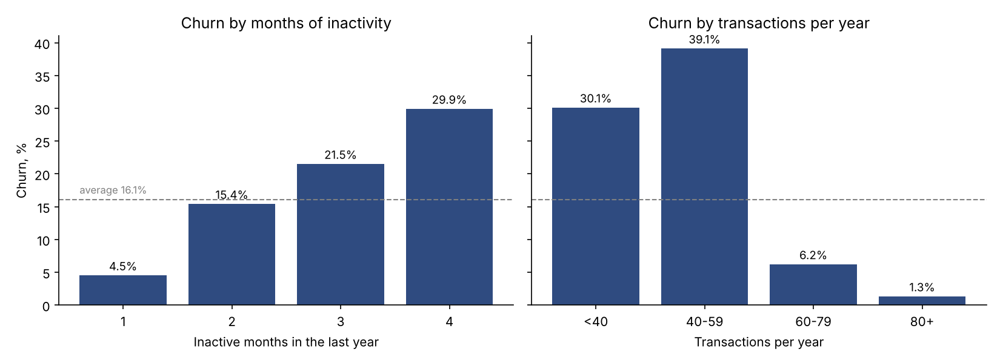

# Credit Card Customer Analytics

**Question:** why do credit card customers leave a bank, and which signals show it early enough to act?

**Status:** work in progress. Blocks 1–2 are done; segments and an A/B test are next.

**Data:** [Credit Card Customers (BankChurners)](https://www.kaggle.com/datasets/sakshigoyal7/credit-card-customers), 10,127 customers of a bank, 1,627 of whom left. The notebook loads a GitHub mirror of the original Kaggle file.

**Tools:** SQL (DuckDB) for all calculations, Python (pandas, matplotlib) for loading data and charts, Google Colab.

**Notebook:** [credit_card_analytics.ipynb](credit_card_analytics.ipynb)

## Key findings so far

1. **Overall churn is 16.1%**, about one customer in six.
2. **Who the customer is barely matters.** Card type and income change churn by only 2–4 p.p.; the extreme groups are tiny (only 20 Platinum customers). Income is unknown for 11% of customers.
3. **How actively the card is used matters a lot.**
   - Customers who left made ~45 transactions a year vs. ~69 for those who stayed.
   - Churn grows with every inactive month: 4.5% (1 month) → 15.4% → 21.5% → 29.9% (4 months).
   - Below ~60 transactions a year (about 5 a month) churn is 30–39%; above it, 6% or less.
4. **Contacts with the bank** go together with churn (1.8% with no contacts, 100% with 6). This may partly record churn itself, such as calls to close the account (possible data leakage), so it needs checking before use as an early signal.

**What it could mean for the bank:** falling card activity looks like an early warning sign. A retention offer around the 2nd–3rd inactive month, or when a customer drops below ~5 transactions a month, is a candidate to test. These are correlations, not proven causes; an A/B test is the way to check.

## Plan

- [x] **1. Churn overview:** overall churn, cuts by card type, income, activity
- [x] **2. Where does the risk start?** Thresholds by inactivity, transactions and contacts
- [ ] **3. Segments:** combine signals to find the riskiest customer group; explain why customers with fewer than 40 transactions churn less than those with 40–59
- [ ] **4. A/B test:** evaluate a retention offer: conversion, statistical significance, sample size, launch decision

## Author

Alisa Solodovnik · [LinkedIn](https://www.linkedin.com/in/alisa-solodovnik-77796b446) · [Business analysis portfolio](https://github.com/SolodovnikA/business-analysis-portfolio)
